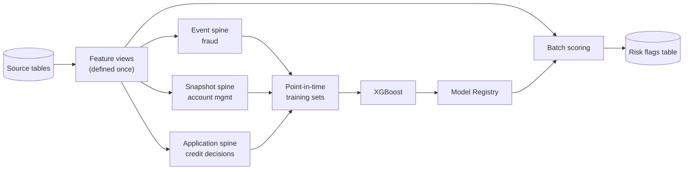

# Feature Store Spines

Define features once, then build a different **spine** for each model and let Snowflake join
features as they were known at each decision. One set of feature views serves fraud,
account management, and credit decisioning without any leakage.

**Audience:** Data scientists who compute features inside training notebooks today and want them reusable, scheduled, and point-in-time correct

| File | Purpose |
|---|---|
| [`feature_store_spines.ipynb`](feature_store_spines.ipynb) | Synthetic card data, entity and feature views, three spine types, leakage comparison, XGBoost, Model Registry explanations, batch scoring. Verified end to end |

Run it in a Snowflake Workspace notebook. It creates `FEATURE_STORE_DEMO` and a SMALL warehouse and takes about 5 minutes.

> **Reference only — no support provided.** Validate against the linked docs before production use.

---

## Start Here

| If you want to... | Go to |
|---|---|
| Understand what a spine is | [1. Spines](#1-spines) |
| Move notebook feature code into reusable definitions | [2. Feature Views](#2-feature-views) |
| Build a training set without leakage | [3. Training Sets](#3-training-sets) |
| See what leakage costs in production | [4. Why Point-in-Time](#4-why-point-in-time) |
| Explain an individual decision | [5. Explanations](#5-explanations) |
| Score with the same features you trained on | [6. Batch Scoring](#6-batch-scoring) |
| Apply this to your own tables | [7. Adapting](#7-adapting-to-your-data) |

---

## Why a Feature Store

| Features in a training notebook | Snowflake Feature Store |
|---|---|
| Feature code copied into each model | One definition, reused by every model |
| Refreshed when someone reruns the notebook | Managed feature views refresh on a schedule, daily to near-continuous |
| Join logic decides what's "as of" the decision | As-of join on the spine timestamp, every time |
| Training and scoring compute features separately | Same definitions for both |
| Output tables with no history | Versioned feature views with lineage to datasets and models |



---

## 1. Spines

The spine is the one model-specific piece: **which entity**, **at what moment**, and **what
happened afterwards**. Everything else is shared.

| Spine | One row per | Timestamp | Label | Typical model |
|---|---|---|---|---|
| **Event** | transaction | transaction time | fraud? | fraud |
| **Snapshot** | account x period | period end | bad outcome in next N days? | limit management, collections |
| **Application** | application or request | submission time | default within N months? | credit decisioning |

A spine can also carry request-time values that aren't stored features, such as a transaction's
amount or hour. They pass straight through to the training set.

```python
fraud_spine = session.sql("""
    SELECT TXN_ID, CUSTOMER_ID, TXN_TS, AMOUNT, HOUR(TXN_TS) AS TXN_HOUR,
           IFF(IS_FRAUD, 1, 0) AS IS_FRAUD
    FROM TRANSACTIONS
    WHERE IS_FRAUD OR ABS(HASH(TXN_ID)) % 20 = 0     -- keep all fraud, sample 5% of the rest
""")
```

---

## 2. Feature Views

A feature view is a named, versioned query keyed on an entity, with a timestamp that says
**when each value became known**.

```python
from snowflake.ml.feature_store import FeatureStore, Entity, FeatureView, CreationMode

fs = FeatureStore(session, database="FEATURE_STORE_DEMO", name="FEATURE_STORE",
                  default_warehouse="FEATURE_STORE_DEMO_WH",
                  creation_mode=CreationMode.CREATE_IF_NOT_EXIST)

customer = Entity(name="CUSTOMER", join_keys=["CUSTOMER_ID"])
fs.register_entity(customer)

payment_fv = fs.register_feature_view(
    FeatureView(name="PAYMENT_BEHAVIOR", entities=[customer],
                feature_df=session.sql(payment_behavior_sql),
                timestamp_col="FEATURE_TS",
                refresh_freq="1 day"),          # managed: backed by a dynamic table
    version="V1")
```

| Type | How | Use when |
|---|---|---|
| Managed | `refresh_freq` set | Snowflake should keep the features current |
| External | no `refresh_freq` | Another pipeline already maintains the table or view |

**Set the timestamp to when the value was known, not when the event happened.** A day's spend is
complete at the start of the next day, so the daily feature view timestamps it there. That way a
transaction at 2pm only sees spend through the previous day.

---

## 3. Training Sets

```python
training_set = fs.generate_training_set(
    spine_df=acct_spine,
    features=[payment_fv, txn_fv, profile_fv],
    spine_timestamp_col="SNAPSHOT_TS",      # as-of join on this column
    spine_label_cols=["WILL_HIT_30DPD"],
)
df = training_set.to_pandas()               # straight into XGBoost
```

The same three feature views feed all three spines in the notebook, so a third model needs no
new feature code. Use `fs.generate_dataset(...)` instead when you want an immutable, versioned
snapshot of the training data.

---

## 4. Why Point-in-Time

The notebook trains the same model two ways on the same out-of-time test window:

| Training join | Offline test AUC | AUC on the features production sees |
|---|---|---|
| Naive: latest features per customer | 0.896 | **0.809** |
| Point-in-time (`spine_timestamp_col`) | 0.913 | 0.913 |

The naive model learned from values that weren't known yet at decision time, so its offline score
doesn't hold up when it runs in production. Omitting `spine_timestamp_col` gives you that same
naive join.

---

## 5. Explanations

Log the model with background data and an `explain` method returns Shapley values for each
prediction, which you can turn into reason codes for a decline or limit change.

```python
mv = reg.log_model(model, model_name="ACCOUNT_RISK_30DPD", version_name="V1",
                   sample_input_data=X_train.sample(500),        # background data
                   target_platforms=["WAREHOUSE"],
                   options={"enable_explainability": True})

mv.run(one_customer, function_name="explain")    # one contribution column per feature
```

Explainability is a preview feature. It supports XGBoost, LightGBM, CatBoost, and scikit-learn.

---

## 6. Batch Scoring

Scoring reads the **same** feature views as of now, so training and production can't drift
apart.

```python
spine = session.table("CUSTOMERS").select(
    "CUSTOMER_ID", F.current_timestamp().cast("TIMESTAMP_NTZ").alias("SCORE_TS"))

features = fs.retrieve_feature_values(spine, features=[payment_fv, txn_fv, profile_fv],
                                      spine_timestamp_col="SCORE_TS")
mv.run(features, function_name="predict_proba").write.save_as_table("ACCOUNT_RISK_FLAGS")
```

Schedule the notebook from its **Schedule** menu, or move this cell into a task. The feature
views refresh on their own, so the job only reads them.

---

## 7. Adapting to Your Data

| In the notebook | Replace with |
|---|---|
| `RAW.*` synthetic tables | Your transaction, statement, and account tables |
| Feature view SQL | Your existing feature code, one view per grain and source |
| The three spines | The decision events and labels from your current training data |
| `XGBClassifier(...)` | Your model code, unchanged |
| `ACCOUNT_RISK_FLAGS` | Wherever downstream teams read scores |

Keep model-specific transforms (ratios against request values, encoding, scaling) in model code.
Keep reusable aggregates in feature views.

**Cleanup:** `DROP DATABASE FEATURE_STORE_DEMO; DROP WAREHOUSE FEATURE_STORE_DEMO_WH;`

---

## Docs

- [Feature Store overview](https://docs.snowflake.com/en/developer-guide/snowflake-ml/feature-store/overview)
- [Model explainability](https://docs.snowflake.com/en/developer-guide/snowflake-ml/model-registry/model-explainability)
- [Model Registry](https://docs.snowflake.com/en/developer-guide/snowflake-ml/model-registry/overview)
